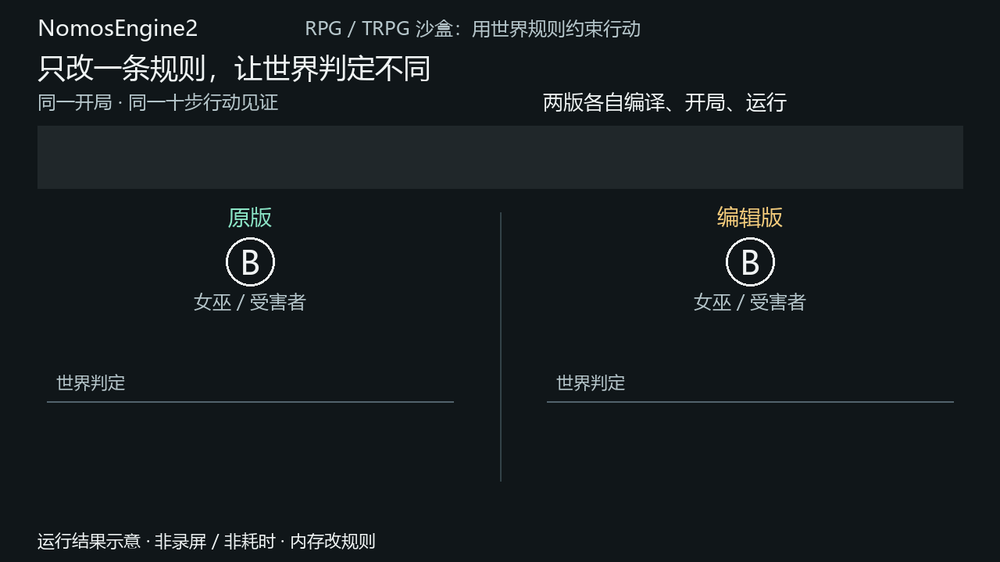

# NomosEngine2

**用作者声明的世界规则产生可玩故事，而不是手写剧情分支树。**

RPG/TRPG 沙盒中，玩家可能做出剧本没有预料的选择。我们的目标是让作者定义人物能力、
物件状态和世界规律，由共同的执行内核检查行动并结算后果，让故事成为实际行动留下的历史。
当前已经实现一条有限的规则编译与运行链，以狼人杀和冰宫冒险检验它，而不是宣称完成了通用 TRPG。

## 改一条规则，改变一次真实判定

同一个六人开局、同一条十步行动见证，只给女巫救人分支增加：

```yaml
- not_self: actor.name != scene.pending_attack
```

| 同一行动见证 | 原规则 | 加入「不能自救」 |
| --- | --- | --- |
| 前九步 | 发布 12 条 Action/Event | 完整来源前缀相同 |
| 第十步：女巫 B 救自己 | 成功，目标达成 | K0 拒绝，不发布这次行动 |



动图用连续运动解释请求、判定与实际发布记录，不是编辑器录屏或执行计时。工具只在内存改一条规则，原文件不变；
两次重新编译、开局和实际回放，不由演示脚本写入结局。

## 五分钟复现

从仓库根执行（Windows 可将 `.venv/bin/python` 换成 `.venv\Scripts\python.exe`）：

```bash
python3 -m venv .venv
.venv/bin/python -m pip install -e '.[dev]'
.venv/bin/python tools/release_rule_edit_demo.py
```

输出应包括 `unchanged_published_prefix: 12`，原版 `goal_status: met`，
编辑版 `stop_reason: k0_not_admitted`、`requested_step: 10`。
`--json` 显示完整发生来源；[两分钟讲解](docs/SHOWCASE.md)提供演示顺序和本次原始证据。
要亲手编辑文件，按[作者指南](docs/AUTHORING.md)操作。
演示开局 B 是女巫；下列普通交互开局 B 是村民，不混为同一个开局。

```bash
.venv/bin/python -m nomos_examples werewolf
.venv/bin/python -m nomos_examples everflame
```

狼人杀输入当前编号、`seat B` 换席或 `quit`；每轮自动显示本地视图，不接受 `view`。
冰宫入口接受 `view` 重看本人已授权信息。资源随安装包分发，不依赖仓库工作目录。
换席由同一受信控制者操作，不是多人登录或身份认证。

## 实现方法

```text
规则库 / 端口 / 世界声明 ── C0 编译器 ── 规则 Program
规则 Program + 开局 Assets ── Start ── K0 Session
玩家或 NPC 的行动提议 ── 当前态准入与原子结算 ── 实际发生 / 本地读回

T0：用同一个 Program 和 Assets 实际执行有限行动见证，检查目标是否达成。
```

Source 声明允许发生什么，不指定剧情必须如何发生；见证是独立验证输入。
T0 只报告这条有限见证的运行结果，不证明所有可能行动都不可达。

## 代码地图

| 路径 | 职责 |
| --- | --- |
| `src/nomos_c0/` | 作者文件前端、名义类型、语义 IR、绑定与 Session 控制 |
| `engine/kernel/src/nomos_kernel/` | 当前态准入、owner 贡献、因果/due 与原子发布 |
| `src/nomos_t0/` | 对同一编译产物运行有限行动见证，不另模拟世界 |
| `src/nomos_c0/examples/` | 狼人杀规则和编译器区别案例 |
| `src/nomos_examples/everflame/` | 冰宫冒险的规则、区域、控制与开局 |
| `tests/`、`engine/kernel/tests/` | 具名短合同测试，不以整局代替底层测试 |
| `tools/` | 规则编辑实验、安装检查、画像和测量 |

[代码导览](docs/CODE_MAP.md)沿一条实际规则定位关键实现；
[选定语义](docs/SEMANTICS.md)说明合同与排除项；
[测试指南](docs/TESTING.md)提供具名测试入口。
各层入口：[C0](src/nomos_c0/README.md)、[K0](engine/kernel/README.md)、[T0](src/nomos_t0/README.md)。

## 当前与未来

**当前是本地发行基线，尚未公开发布。** 选定合同的六项审计缺陷已修复并独立复核；
两个世界已从 wheel 独立运行。最后同输入冰宫整局为 43 项行动、1180 条发生，
基线/候选 Run 为 45.056/45.106 秒，状态与来源摘要一致。
这是一组返回门证据，不证明稳定提速、任意规则组合正确或完整原作已电子化。
完整记录见[发行收束](docs/RELEASE_BASELINE_CLOSURE.md)、[重建账](docs/RECONSTRUCTION.md)。

当前只实际验证 Python 3.14.4；`>=3.11` 是语言版本要求，不代表全部平台已测。
尚无通用存档恢复、多人服务或 LLM 主持人。长期希望让 LLM DM 提议行动、草拟可检查资产、
讲述已经发生的故事，规则准入和权威状态仍由内核负责，而不是交给语言模型直接改写。
研究历史保留在原研究仓库，本目录侧重可复现的实现和维护文档。

## 归属与权利

Owner 负责项目愿景、问题定义、语义裁决与亲自验收；后期主要代码由 Codex 及协作者
实现或审阅，不能认领所有代码都是 Owner 手写。
原创引擎材料保留权利；M1 改编作者资产另有 CC BY-SA 4.0 条款，二者不能混成一份授权。
详见[权利说明](RIGHTS.md)。
