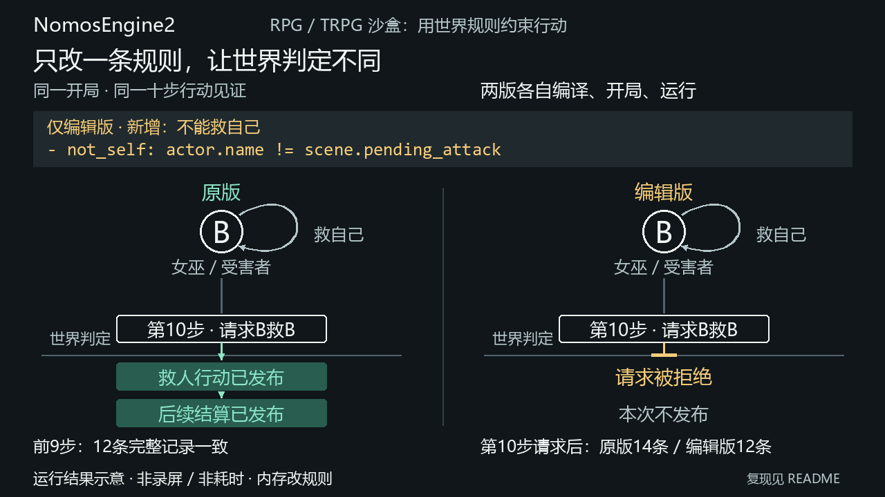

# 两分钟看懂 NomosEngine2

## 讲解顺序

| 时间 | 展示 | 要说明的事实 |
| --- | --- | --- |
| 0:00–0:20 | README 的动机与结果对照 | 希望让规则产生故事，而不是穷举剧情分支 |
| 0:20–0:40 | 下方规则片段 | 仅限制女巫救人分支，开局和行动见证不改 |
| 0:40–1:10 | 实际运行演示命令 | 两次真实 Compile / Start / Run，第十步才出现不同判定 |
| 1:10–1:30 | 来源前缀与完整报告 | 前九步 12 条记录一致；拒绝不发布本次行动 |
| 1:30–2:00 | 代码导览与边界 | C0 编译、K0 结算、T0 检查；LLM DM 是未来方向 |

不要把动图播放时间当执行耗时；安装时间也不包含在讲解时间内。
首次安装耗时因网络和环境而异，「五分钟」是导航目标，不是性能承诺。

## 运行与亲手编辑

安装步骤见根 [README](../README.md)。从仓库根运行：

```bash
.venv/bin/python tools/release_rule_edit_demo.py
.venv/bin/python tools/release_rule_edit_demo.py --json
```

首命令给简要结论，第二条展开实际来源。两条均在内存修改规则，不写入作者文件。
它们比较同一开局、同一十步见证，不是把普通交互局的 B 村民变成女巫。
原版达成目标；编辑版在第十步 K0 拒绝。**对照工具本身正常结束为 exit 0**，
因为它已经核对出了预期差异；直接运行编辑后的 T0 作者检查则为 exit 3。

亲手编辑时，按[作者指南](AUTHORING.md)在救人分支添加：

```yaml
- not_self: actor.name != scene.pending_attack
```

随后运行指南中的 `nomos_t0.author_check_v0` 命令，撤回该条件后重新编译。
只改 Law，不改 Assets、见证或 Python 执行器。候选选项不等于当前态最终准入，
因此「救人」选项仍可出现而被 K0 拒绝。

## 本次真实结果



GIF 用连续运动解释请求与判定：同一个 B 请求救自己，原版在判定后生成行动与结算记录，
编辑版请求止于边界，本次不发布。人物与规则位置保持固定，末态停留五秒。
PNG/GIF 是实际运行报告的讲解可视化，不是终端或编辑器录屏；没有伪造执行进度。
完整输入摘要、代码版本、解释器、模块来源见 [manifest](showcase/manifest.json)，
实际工具输出见 [result](showcase/result.json)。报告中的 occurrence 整数仅在各次运行内有意义；
完整前缀比较是在这组相同输入的新会话中作对照，不宣称跨局身份。

此材料以发行仓库 `bc3578649dfab987727f4b7654a7099dada6d1ea` 为代码基准，
生成时核心和作者文件没有工作树修改。两个仓库共用同一份证据，
不是两次独立实验，也不证明主仓库所有研究组合均正确。随后文档修改不改变这次运行。

## 重做画面

新版连续动画按[分镜与评委批评](showcase/ANIMATION_DESIGN.md)制作，共 23 秒。
可查看[六个关键帧](showcase/storyboard.png)与[800px 末态](showcase/rule-edit-800.png)。
[动画元数据](showcase/animation.json)记录时序、文本边界和素材摘要；
原始 `manifest.json` 的 `media` 字段保留首次四页素材的历史描述，不代表当前动效。

`showcase/render.py` 是文档素材工具，不参与结算。
仅重做图片才需要额外安装 Pillow；正常演示和引擎均不依赖它。

```bash
python3 -m pip install pillow
python3 docs/showcase/render.py --reuse-report \
  --font /path/to/chinese-font.ttf --mono /path/to/monospace-font.ttf
```

Windows 可使用 `C:/Windows/Fonts/msyh.ttc` 和 `C:/Windows/Fonts/consola.ttf`；
字体路径由使用者显式提供，字体不随本项目复制。`--reuse-report` 核对已存报告的
摘要与实际记录，再重绘；不运行世界，也不更新原实验的版本或时间。
若需要重新采集当前代码的实验，去掉该参数。脚本核对结果后保存新报告、摘要和画面，
若当前规则不再满足这项实验，直接报错，不沿用旧成绩。

## 深入阅读

- [代码导览](CODE_MAP.md)：沿实际救人规则阅读实现与测试。
- [作者指南](AUTHORING.md)：文件位置、条件层级、人数和职业调整。
- [语义](SEMANTICS.md)：选定支持、有限拒绝与明确排除项。
- [发行收束](RELEASE_BASELINE_CLOSURE.md)：安装、修复和性能证据。

下一阶段应优先让陌生读者按这些入口复现，再根据定位困难改文档；
不为拍摄素材扩世界规则，也不让长性能测量阻塞展示。

## 本批核对

首次采集，2026-10-10：发行代码实际运行原版与规则编辑版，完整报告已保存；
静态图已查看，GIF 为四帧、1280×720、15 秒。两份 README、讲解与代码导览的
本地链接均存在。素材证据具名模块 `tests/nomos_c0/test_showcase_evidence_v1.py`
writer 6 passed（1.40 秒），覆盖真实报告、篡改来源/计数/停点/成功声明及摘要核对；
同一审阅者独立复跑发行仓库该模块 6 passed（1.24 秒），未运行其他门。
Ruff 与两仓库 diff 检查通过。一次干净上下文的只读招聘视角审阅未发现实质阻碍，
这不等于真人招聘反馈或独立实玩。未新增核心测试门、M1 长路线或性能测量。

连续动画批次复用上述报告，未再运行 Compile / Start / Run。
末态与关键帧已实际检查，GIF 编码时序核对为 23 秒；具体素材审阅意见见分镜文档。
素材工具的短测试覆盖记录来源、复用摘要、运动/发布时序与当前文件摘要，不替代引擎测试。
终版 writer 具名素材模块 11 passed（1.30 秒），Ruff 通过；没有运行其他 pytest 模块。
发行目录使用主树测试解释器复跑同一具名模块，11 passed（1.44 秒），这是 writer 同步核对，
不是独立技术验收。实际 GIF 抽帧确认顶部固定、请求移动、末态静止，72 帧共 23 秒，420413 字节。
评委已复看修正后的 800px 末态，未发现新溢出；详见分镜文档，不宣称真人首看接受。
