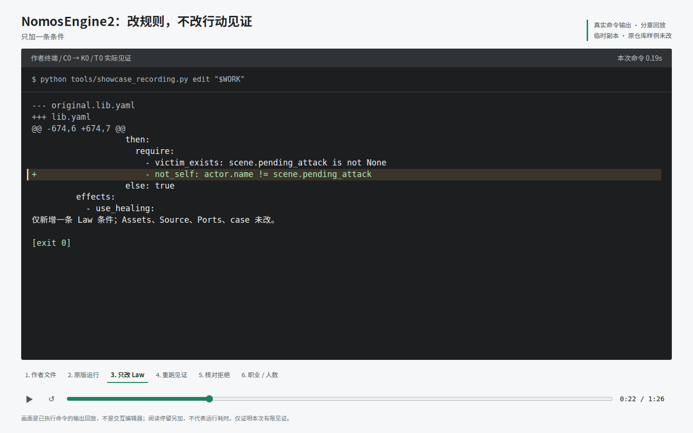

# 真实规则编辑记录

这份演示录制实际命令的 stdout、退出码与证据，然后将输出做成分章终端回放。
不是 GUI 编辑器录屏，也不由播放器执行或模拟 K0。命令之间另加阅读停留，不能把视频长度当运行耗时。

## 当前示例

- [86 秒视频](capture-v1/demo.webm)：无声音，新增条件与拒绝位置高亮。
- [可暂停、拖动、选章的本地回放](capture-v1/replay.html)：下载仓库后直接用浏览器打开；GitHub 不执行仓库中的 HTML。
- [真实文件差异](capture-v1/law.diff)、[原版](capture-v1/original.json)、[改后](capture-v1/changed.json)与[拒绝核对](capture-v1/comparison.json)。
- [职业与人数原始报告](capture-v1/world.json)、[采集摘要](capture-v1/manifest.json)与[视频导出记录](capture-v1/video-export.json)。

本次代码版本、实际子进程模块来源和采集时工作区变化记录在 manifest。
采集前后检查引擎、录制工具与输入摘要不变；新证据目录本身尚未提交，不宣称它是干净提交的整个镜像。
页面与视频只消费已录输出；视频开头可能包含很短的页面/字体载入段，不含人工鼠标编辑操作。
字体只在导出本机加载，没有随仓库分发。



## 看什么

1. 从实际 Lib 读取女巫救人分支；复制到临时目录，原仓库不改。
2. 原版由 T0 实际编译、开局和执行十步见证，发布十四条发生。
3. 临时 Lib 只增加 `not_self: actor.name != scene.pending_attack`，显示真实 diff。
4. 重新 Compile/Start，同一 Assets 与 case 在第十步被 K0 拒绝；前九步的十二条发生完全相同。
5. 另开诊断 Session，核对相同已发布前缀、实际失败谓词与完整状态不变。
6. 运行已有换职业、扩人数实验，展示本人选项与真实 Action 来源的联动。

第五段的 `Save victim` 仍存在。这里只证明准入拒绝没有写入，不冒称菜单自动过滤、故障回滚或全部玩法不可达。
最后一段使用已有工具同步编辑必要的参与者、角色与私有开局；报告保存实际开局状态、选项与发生，
不保存完整有效 YAML。不假装所有内容只需改一个人数或职业开关；
要留存那些完整输入，可另用 `release_world_edit_demo.py --record`，本演示没有这样做。

## 重新录制

录制命令使用 Linux/WSL 的 Bash 与进程组；不影响引擎自身的 Python 安装接口。
在本仓库做 editable 安装后执行，目标目录必须不存在：

```bash
python tools/showcase_recording.py record /tmp/ne2-recording-new
```

生成 `session.cast`、`recording.json`、可直接打开的 `replay.html`、实际报告和摘要。
`manifest.json` 记录代码与输入摘要，摘要证明字节一致性，不是身份认证或发行签名。
完整作者快照用 T0 的带类型结构编码保存；比较发生在真实 Session 内，不由 JSON 摘要替代。
原始 case 和 Assets 文件在录制前后逐字节检查。

可选的视频导出需要 Node 与 Playwright。它是演示工具依赖，不是引擎运行依赖：

```bash
npm install --prefix /tmp/ne2-video-tools playwright
/tmp/ne2-video-tools/node_modules/.bin/playwright install chromium
node tools/render_showcase_recording.cjs /tmp/ne2-recording-new \
  /tmp/ne2-video-tools/node_modules/playwright
```

第三个可选参数是本机字体文件，仅用于输出图片/视频，不复制或分发字体。
浏览器导出录制的是这份既有输出回放，默认无声音；播放器可暂停、拖动或直接选章。
